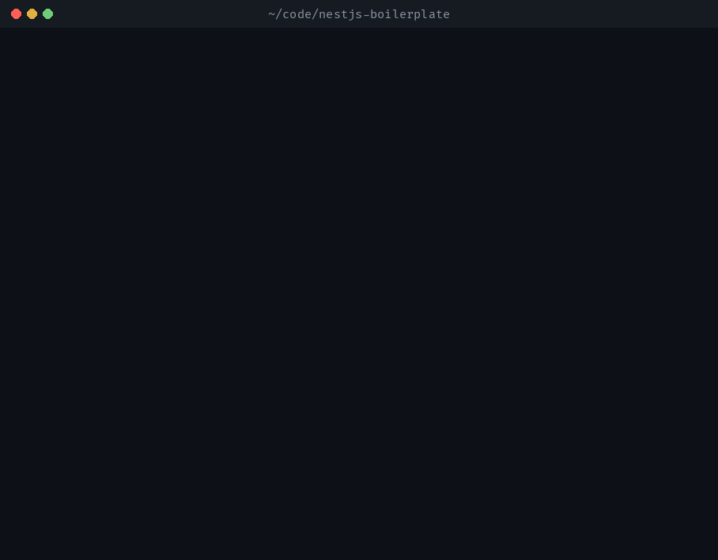
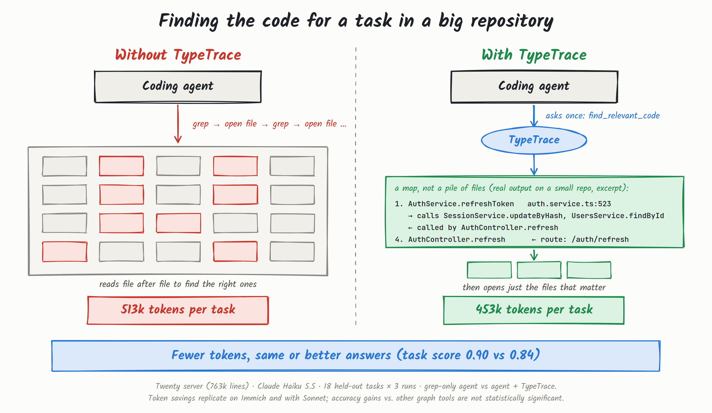
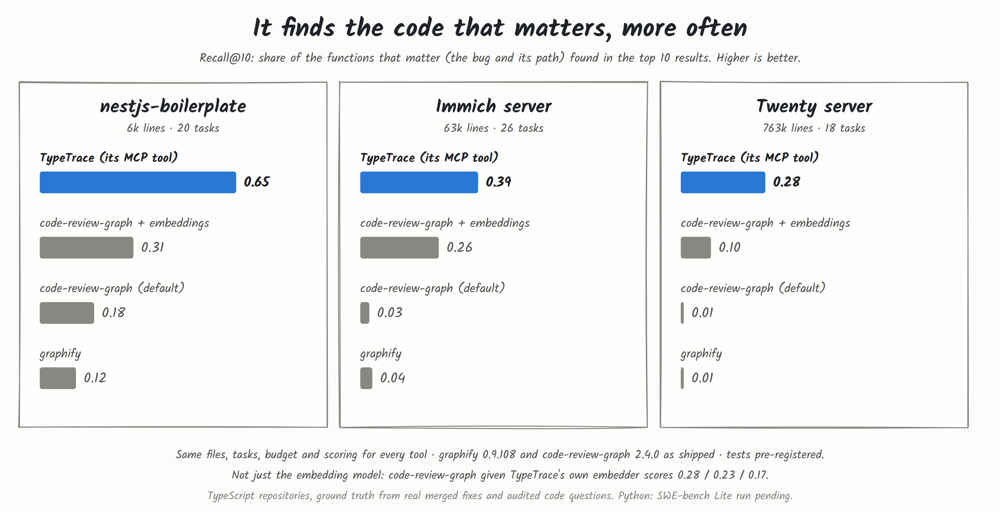
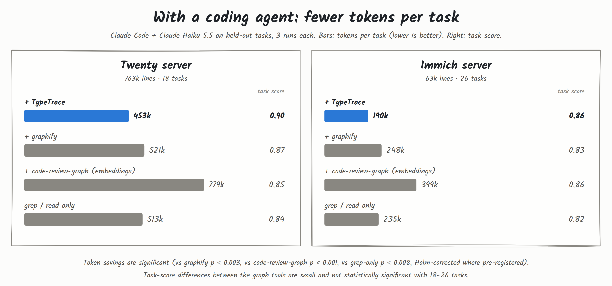
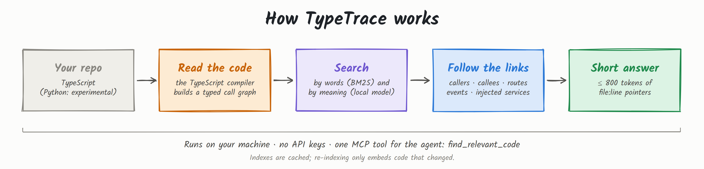
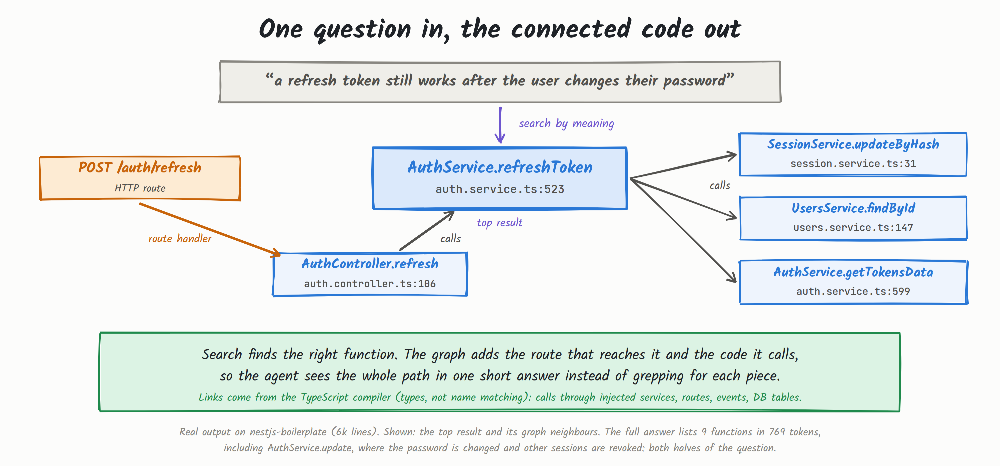

<h1 align="center">TypeTrace</h1>

<p align="center"><strong>Finds the code your AI coding agent needs for a task, and hands it back as a short list of <code>file:line</code> pointers with what calls what.</strong></p>

<p align="center">Local MCP server for Claude Code and other MCP clients · 14 languages, finding code benchmarked in 10 of them · no API keys, nothing leaves your machine · MIT</p>

<p align="center">
  <a href="https://www.npmjs.com/package/typetrace-cli"></a>
  <a href="https://github.com/Atrix21/typetrace/actions/workflows/ci.yml"></a>
  <a href="LICENSE"></a>
  <a href="https://modelcontextprotocol.io/"></a>
  <a href="https://doi.org/10.5281/zenodo.24363177"></a>
</p>

<p align="center"><code>npx typetrace-cli init .</code> in your repository, then restart your AI coding tool.</p>

<p align="center"></p>

---

## What it is

Before a coding agent can fix a bug or change a feature, it has to find the code involved. Usually it greps, opens a
file, greps again and opens another, and every file it reads costs tokens. TypeTrace does that search step for it.

You run one command. It indexes the repository and keeps the index current while you work. The agent gets one tool, `find_relevant_code`. It answers in at most 800 tokens: the
functions most likely involved, where they are (`file:line`), and their callers and callees. The agent then opens
those files instead of searching for them.

For example, on [nestjs-boilerplate](https://github.com/brocoders/nestjs-boilerplate) (first 4 of 12 results, 752 tokens in total):

```text
$ npx typetrace-cli query . "where are refresh tokens validated?"
1. AuthService.validateLogin — src/auth/auth.service.ts:42-97
   → calls: AuthService.getTokensData src/auth/auth.service.ts:599; SessionService.create src/session/session.service.ts:16 +1 more
   ← called by: AuthController.login src/auth/auth.controller.ts:39
2. AuthService.refreshToken — src/auth/auth.service.ts:523-560
   → calls: AuthService.getTokensData src/auth/auth.service.ts:599; UsersService.findById src/users/users.service.ts:147; SessionService.updateByHash src/session/session.service.ts:31
   ← called by: AuthController.refresh src/auth/auth.controller.ts:106
3. AuthController.refresh — src/auth/auth.controller.ts:106-123
   ← route: /auth/refresh src/auth/auth.controller.ts:106 (framework)
4. JwtRefreshStrategy.validate — src/auth/strategies/jwt-refresh.strategy.ts:24-32
```

**What it is not:**
- **Not an agent.** It does not edit code. The agent still reads the files; TypeTrace tells it which ones.
- **Not a replacement for grep.** The agent keeps grep. TypeTrace's measured benefit over grep is fewer tokens on
  tasks that span several files (our TypeScript tasks); on 346 SWE-bench issues it saved none. A gain in correct
  answers on top of grep has not been shown (see [the evidence](#the-evidence-in-one-table)).
- **Not a code-review or change-impact tool.** For blast radius, risk-scored diffs and PR comments, use
  [code-review-graph](#where-the-other-tools-are-the-better-choice).
- **Not a knowledge graph of your docs, PDFs or media, or a memory of past conversations.** That is
  [graphify](#where-the-other-tools-are-the-better-choice).
- **Not a visual map of your architecture.** There is no graph viewer.

**Who it is for:** you use Claude Code (or another MCP client) on a medium or large repository, and you want the agent to
find the right code with less searching and fewer tokens. It is strongest on TypeScript, where it uses the real
compiler and where the call graph measurably helps. With a coding agent it has been measured on our TypeScript tasks
and on [346 SWE-bench issues in ten languages](experiments/10-swebench-agents/findings.md).

<p align="center"></p>

## Quick start

```bash
cd your-repo
npx typetrace-cli init
```

Or install it once (`npm i -g typetrace-cli`) and use the `typetrace` command: `typetrace init`.

That builds the call graph and the keyword index, registers TypeTrace with each [supported AI coding tool](#supported-tools) it finds on your machine, and returns. Building the graph took 22 s on a 63k-line repository and 81 s on a 763k-line one. Semantic search (the embedding model) is then added by a background job at low priority. Until it finishes, search uses keywords and the call graph, and the server switches over by itself. Restart your tool in the repository and approve the `typetrace` server. The agent can then call `find_relevant_code` whenever it needs to find code.

```bash
npx typetrace-cli query . "where are refresh tokens validated?"   # see what the agent sees
npx typetrace-cli status .                                        # what is indexed, what is still running
npx typetrace-cli init . --wait                                   # or: compute the embeddings before returning
npx typetrace-cli init . --no-embed                               # or: keywords + call graph only, no model download
```

**Keeping the index current.** While your tool runs the server, the server rescans the indexed files every 15 seconds. When edits have settled for 10 seconds, it rebuilds the graph in a background job, then embeds only the code that changed. Queries never wait: the previous index answers until the new one is loaded. Changes made while no server runs (a `git pull`, a branch switch) are picked up when it starts. `typetrace index` rebuilds everything in the foreground.

**Requirements and what to expect:**
- **Node.js 22.13 or newer.** No Python, no GPU and no API key needed.
- **First run downloads the embedding model (~2.4 GB, once)** to `~/.cache/typetrace/models`. npm dependencies take about 900 MB, mostly ONNX Runtime.
- **RAM:** 6.5 to 8 GB at the peak of the first index, while embeddings are computed (measured on 120 to 490-file repositories); the MCP server needs less.
- **Semantic search, first time,** is dominated by embedding on the CPU, in the background. Measured on an 8-core laptop CPU (i7-11800H):

  | Repository | Size | Code chunks | First index |
  |---|---:|---:|---:|
  | nestjs-boilerplate | 6k lines | 728 | 4.5 min (incl. model download) |
  | Immich server | 63k lines | 5,764 | ≈ 25 min (estimated from the chunk rate) |
  | Twenty server | 763k lines | 50,151 | ≈ 3.5 h (estimated from the chunk rate) |

  TypeTrace answers before this finishes, with keywords and the call graph ([the fast mode](experiments/09-fast-first-index/)). On repositories up to about 60k lines those answers were as good as the full tool's. On the 763k-line one they were clearly worse (Recall@10 0.17 instead of 0.28) until the embeddings were done; `typetrace status` shows the progress. Re-indexing only embeds code that changed. For very large repositories, index the part you work on (`--include packages/server/src`), or use the GPU backend from a source checkout (`--gpu`, see [Reproducing](#reproducing-the-benchmark)).
- **Languages:** TypeScript, JavaScript, Python, Go, Java, Kotlin, Scala, C#, Rust, C, C++, Ruby, PHP and Swift. How well each is supported, and what has been measured, is in [Languages](#languages).

### Supported tools

`init` registers TypeTrace with Claude Code and with every other tool below that it finds on your machine (`--client all`, `--client cursor,codex` or `--client none` to choose; `typetrace install --dry-run` shows the changes first). It only adds or updates its own `typetrace` entry, and keeps everything else in the file. A file that is not plain JSON (with comments, say) is left untouched, and the entry to paste is printed instead. `typetrace uninstall` removes the entries.

| Tool | Configuration written | Notes |
|---|---|---|
| Claude Code | `.mcp.json`, plus the setup below | |
| Cursor | `.cursor/mcp.json` | |
| VS Code (GitHub Copilot) | `.vscode/mcp.json` | |
| Codex | `.codex/config.toml` | read once you trust the project |
| Gemini CLI | `.gemini/settings.json` | |
| OpenCode | `opencode.json` | |
| Kiro | `.kiro/settings/mcp.json` | |
| Windsurf | `~/.codeium/windsurf/mcp_config.json` | global: serves the indexed repository Windsurf starts it in |
| Zed | `~/.config/zed/settings.json` | global: same |

Files in the repository name the repository. The two global entries name none: the server serves the nearest indexed repository above the directory the tool starts it in, and says so when there is none, rather than answering about another repository.

**Claude Code setup.** For Claude Code, `init` also writes the kind of setup graphify and code-review-graph install, so the agent knows the tool is there. `--no-setup` skips it, and `typetrace uninstall` removes it.

| File | What it adds |
|---|---|
| `CLAUDE.md` | a short block between `<!-- typetrace -->` markers saying when to call `find_relevant_code`; the rest of the file is kept |
| `.claude/skills/typetrace/SKILL.md` | a skill on writing queries and following the callers and callees in the results |
| `.claude/hooks/typetrace-nudge.mjs` and `.claude/settings.json` | a PreToolUse hook. Before a search or a read in the repository it adds one sentence saying that the repository is indexed. It never blocks a call, speaks at most 5 times per session (`TYPETRACE_NUDGE_CAP`), and stays quiet while TypeTrace has been queried in the last 30 minutes |

## The evidence in one table

Every comparison below was specified before it was run, against tool-independent ground truth: the main tests as
pre-registered hypotheses, the rest labelled exploratory in advance. Losses are reported.
Details follow in [Results](#results).

| Question | Answer | How sure |
|---|---|---|
| Does it find the code a task needs better than graphify and code-review-graph? | **Yes, on all three TypeScript repositories.** Recall@10 0.33 to 0.69, against at most 0.31 for either competitor. | Strong: 16 of 18 comparisons p ≤ 0.001 |
| The same, on Python? | **Yes.** [SWE-bench Lite](experiments/05-swebench-python/findings.md), 300 real GitHub issues: Recall@10 0.47 against 0.35 for code-review-graph with embeddings and 0.15 for graphify. The agent tool scores 0.45 in a tenth of the tokens. | Strong: both pre-registered tests Holm p ≤ 0.001 |
| The same, in other languages? | **Yes, in all nine measured.** [SWE-bench Multilingual](experiments/08-swebench-multilingual/findings.md), 299 real issues in Java, Rust, Go, PHP, Ruby, C, C++, JavaScript and TypeScript: Recall@10 0.39 against 0.26 for code-review-graph with embeddings and 0.12 for graphify, ahead in every language. Kotlin, Scala, C# and Swift are not measured. | Strong: both pre-registered tests Holm p = 0.0001 |
| Does a coding agent use fewer tokens with it? | **Than graphify and code-review-graph, yes; than grep alone, it depends on the task.** On our TypeScript tasks, 18 to 28% fewer than grep alone on a typical task, 23 to 34% fewer than graphify and about half of code-review-graph's. On [346 SWE-bench issues in ten languages](experiments/10-swebench-agents/findings.md), the same as grep alone (−1%, not significant), 23% fewer than graphify and 60% fewer than code-review-graph. | Strong: pre-registered, every comparison listed |
| Does the agent get more answers right? | **No.** On [346 SWE-bench issues](experiments/10-swebench-agents/findings.md) every arm found a changed function in its top three in 81% of issues (TypeTrace 0.809, grep alone 0.812, graphify 0.808, code-review-graph 0.812), and the 95% CI rules out a gain over grep above 0.014. On our TypeScript tasks, five runs ranged from −0.02 to +0.06 against grep alone. | Strong for SWE-bench: pre-registered, n set by a power analysis |
| Is it cheaper in dollars? | On the 763k-line repository, yes (cheapest arm). On the 63k-line one, about the same as graphify and grep: cached prompt tokens are cheap. | Measured, two repositories |
| Does the call graph help, beyond plain search? | On our TypeScript repositories, for finding code, yes on the smallest and largest (Recall@10 +0.24 and +0.16). **On SWE-bench, no**, in any language: −0.02 on Python, −0.00 across the nine others, neither significant; there the lead comes from the search stack. Inside the agent, no difference on either (within 0.02 on TypeScript; −0.001 on 346 SWE-bench issues). | Mixed |

## Where the other tools are the better choice

TypeTrace does one job: find the code for a task. The other tools do more, and some things better. Each point below
comes from their own documentation or from our measurements.

**[graphify](https://github.com/Graphify-Labs/graphify)** is a better fit if you want:
- **Breadth.** About 40 programming languages, plus docs, PDFs, images and audio/video in the same graph. TypeTrace reads
  14 languages and only code.
- **An architecture overview.** A report of the most-connected parts of the code and its subsystems, and `path` and
  `explain` queries. TypeTrace has no overview.
- **A complete index quickly.** No embedding model to download. In our runs it indexed the 763k-line Twenty server in
  under 2 minutes. TypeTrace answers after about 1.5 minutes on the same repository, but only with keywords and the
  call graph; its semantic search takes about 3.5 hours on a laptop CPU to finish in the background, and until then its
  answers are clearly worse on that repository (Recall@10 0.17 instead of 0.28, [measured](experiments/09-fast-first-index/)).
- **Similar agent accuracy.** With a coding agent, its task scores were not significantly lower than TypeTrace's
  (0.867 vs 0.896 on Twenty, 0.833 vs 0.860 on Immich, 0.808 vs 0.809 on 346 SWE-bench issues). TypeTrace's
  advantage there is tokens, not correctness.

**[code-review-graph](https://github.com/tirth8205/code-review-graph)** is a better fit if you want:
- **Code review.** Blast-radius analysis of a change, risk-scored `detect_changes`, and a GitHub Action that posts PR
  comments and can block a merge. TypeTrace has none of this.
- **Fast updates, also outside agent sessions.** Git and editor hooks and a watch mode re-parse only the changed files
  (about 2.5 s for a two-file edit, by its own measurement). TypeTrace updates only while its server runs, and
  rebuilds the whole graph each time (81 s on the 763k-line repository).
- **More tools.** One `install` configures more than 15 AI coding tools. TypeTrace's `init` configures
  [9](#supported-tools).
- **Extras:** an interactive graph view, an architecture overview, dead-code and rename tools, exports to GraphML, Neo4j
  and Obsidian, and framework-aware Java (Spring) and PHP (Laravel) parsing.
- **A quick start.** Its default mode needs no model. It indexed Twenty in under a minute in our runs.
- **Equal agent accuracy on Immich** (0.859 vs 0.860), though with about twice the tokens.

**Plain grep, which your agent already has**, wins on cost of ownership. There is nothing to install, no index to keep
up to date, no 2.4 GB model and no 6 to 8 GB of RAM while indexing. Agents are already good at searching with it: on 346
SWE-bench issues, grep alone matched every tool in accuracy and TypeTrace in tokens. TypeTrace saved 18 to 28% of tokens
only on our TypeScript tasks, where the code for a task is spread over more files.

## What the other tools' headline numbers measure

Their READMEs quote numbers that look much larger than ours. They measure different things, and their own
documentation says so:

| Their claim | What it compares | The closest real-world measurement |
|---|---|---|
| code-review-graph: "~63x fewer tokens" | The **whole repository pasted into the prompt**, against one graph answer. Its README calls this baseline "an upper bound no real agent pays". | Its own comparison against grep is 6.65x, for the tokens needed to locate an answer only. In our full Claude Code sessions, the agent with code-review-graph used **more** tokens than with grep alone: 52% more per task on average on Twenty, 70% more on Immich. The agent still reads the files after the graph answers. |
| graphify: "0.497 recall@10" | LOCOMO: finding the right turns in long **chat conversations**. No code is involved. | On an open LOCOMO protocol, BM25 plus our embedding model scores 0.635, and 0.745 with a cross-encoder reranker that TypeTrace does not ship ([below](#locomo-conversational-memory-search-components-only)). Different harness, so not a like-for-like win. |
| graphify: "cut agent token spend by 80%" | Graphify Cloud, its paid hosted product, which we did not test. | The open-source graphify we tested: 2% more tokens per task than grep alone on Twenty, 6% more on Immich (averages). |
| code-review-graph: impact F1 0.69 | Ground truth built from its own graph. Its README calls the recall "a circular upper bound". | Not run. Our change-impact tasks use a type-checker as the oracle instead. |

So TypeTrace has **not** been shown to beat these tools on their own benchmarks. It beats them at finding code on ours
(real TypeScript repositories) and on two public ones chosen by others (SWE-bench Lite in Python, SWE-bench
Multilingual in nine other languages), with ground truth
independent of every tool and the competitors as shipped. Which of their
benchmarks we ran:

| Their benchmark | Run with TypeTrace? | Why |
|---|---|---|
| graphify: LOCOMO recall@10 / QA | recall only, on an open protocol (below) | their harness is not public; QA needs their LLM reader and judge |
| graphify: LongMemEval-S | no | conversational memory, not code |
| graphify: ERPNext cross-tool (Python, n = 6) | no | we ran SWE-bench Lite instead: 300 Python issues, ground truth from the merged fixes ([results](experiments/05-swebench-python/findings.md)) |
| graphify: FastAPI edge-precision audit | not yet | our own edge audits: 100/100 sampled TypeScript edges correct after fixes ([edge audit](experiments/03-graph-scale/dataset/audit/)), 151/156 in 11 other languages ([experiment 7](experiments/07-languages/)) |
| code-review-graph: token reduction on fastapi, flask, gin, httpx, express | no | measures answer size against the whole repository; we measure tokens of real agent sessions instead |
| code-review-graph: impact F1 on 13 commits | no | its ground truth comes from its own graph |

## Results

Results 1 and 2 are measured on three real TypeScript repositories of increasing size, results 3 and 4 on SWE-bench Lite (Python) and SWE-bench Multilingual (nine other languages), against [graphify](https://github.com/Graphify-Labs/graphify) 0.9.108 and [code-review-graph](https://github.com/tirth8205/code-review-graph) 2.4.0. Both ran at their latest releases at the time of the runs (pinned), through their own MCP servers, on exactly the same files. The tests were pre-registered before the runs, losses are reported, and [everything is reproducible](#reproducing-the-benchmark).

### 1. Does it find the right code? (retrieval, no model calls)

**Recall@10** is the share of the ground-truth functions (a bug's root cause and the functions on its path, or the functions a code question is about) found in the top 10 results.

<p align="center"></p>

The table gives TypeTrace's two variants: the full hybrid ranking, and the ≤800-token agent tool shown in the chart.

| Repository | Lines | Tasks | **TypeTrace** (hybrid) | **TypeTrace** (agent tool, ≤800 tok) | code-review-graph + embeddings | code-review-graph (default) | graphify |
|---|---:|---:|---:|---:|---:|---:|---:|
| nestjs-boilerplate | 6.3k | 20 | **0.69** | **0.65** | 0.31 | 0.18 | 0.12 |
| Immich server | 63k | 26 | **0.48** | **0.39** | 0.26 | 0.03 | 0.04 |
| Twenty server | 763k | 18 | **0.33** | **0.28** | 0.10 | 0.01 | 0.01 |

- **TypeTrace is ahead at every scale.** Paired over tasks, 16 of the 18 TypeTrace-vs-competitor comparisons have p ≤ 0.001. The two exceptions are on Immich against code-review-graph + embeddings: hybrid +0.21 (p = 0.025) and the agent tool +0.12 (p = 0.12, not significant).
- **It is not just a better embedding model.** We re-ran code-review-graph with TypeTrace's own embedding model (Qwen3-Embedding-0.6B). It scored 0.28, 0.23 and 0.17, still well below TypeTrace on every repository (p < 0.01 each).
- **The graph matters most on the smallest and the largest repository, not in proportion to size.** The same search without the graph scores 0.44, 0.43 and 0.17; with it, 0.69, 0.48 and 0.33. The pre-registered test that the graph's contribution grows with size was not supported.
- **Why the competitors score so low here.** code-review-graph's default search is keyword-only; its own documentation says natural-language questions "hit FTS5 only and return nothing" without embeddings, which is why the embeddings variant is in the table. graphify's `query` matches keywords to graph nodes and returns their neighbourhood. It often finds the right file but not the function. Our scoring credits each tool's results by name or by line range, with the same rules for every tool ([`normalise.ts`](src/evaluation/normalise.ts)).

Full table with MRR, file recall, output size and latency: [`h2h-report.md`](experiments/03-graph-scale/results/h2h-report.md).

### 2. Does it make a coding agent better or cheaper?

Claude Code, headless, with the read-only tools Read, Grep and Glob plus the arm's MCP server. Held-out bug reports and code questions, 3 repeats per task and arm, scored automatically against frozen ground truth (no LLM judge).

<p align="center"></p>

**Twenty server (763k lines), Claude Haiku 5.5, 18 tasks:**

| Arm | Task score | Tokens / task | Cost / task | Tool adoption |
|---|---:|---:|---:|---:|
| **+ TypeTrace** | **0.896** | **453k** | **$0.019** | 100% |
| + graphify | 0.867 | 521k | $0.022 | 87% |
| + code-review-graph (with embeddings) | 0.851 | 779k | $0.041 | 81% |
| grep / read only | 0.837 | 513k | $0.023 | — |

**Immich server (63k lines), Claude Haiku 5.5, 26 tasks:**

| Arm | Task score | Tokens / task | Cost / task | Tool adoption |
|---|---:|---:|---:|---:|
| **+ TypeTrace** | **0.860** | **190k** | $0.013 | 100% |
| + graphify | 0.833 | 248k | $0.013 | 92% |
| + code-review-graph (with embeddings) | 0.859 | 399k | $0.019 | 69% |
| grep / read only | 0.816 | 235k | $0.013 | — |

**Twenty server, Claude Sonnet 5.5, 18 tasks × 2 (TypeTrace vs grep only):** task score 0.873 vs 0.845, 166k vs 209k tokens per task.

What this shows (pre-registered tests, Holm-corrected, paired by task):
- **Fewer tokens: yes, every time.** The test compares tokens task by task, so the percentages below are for a typical task (the geometric mean of the per-task ratios). Against graphify, 23% fewer on Twenty (p = 0.003) and 34% fewer on Immich (p < 0.001). Against code-review-graph, about half the tokens on both (p < 0.001, fewer on 43 of 44 tasks). Against grep only, 18–28% fewer on all five runs (p ≤ 0.03), including the two pre-registered ones. The tables show averages per task, where a few long tasks weigh more: 12% fewer than grep only on Twenty, 19% on Immich and 21% with Sonnet (9% and 14% in the two pre-registered Haiku runs).
- **More correct answers: not shown.** TypeTrace scores highest or tied in both head-to-head runs, but its accuracy leads over graphify and code-review-graph are **not statistically significant** with 18–26 tasks. Against grep only, the five runs disagree: +0.06 on Twenty (p = 0.03) and +0.04 on Immich (p = 0.02) in the head-to-head runs with Haiku; +0.03 with Sonnet; +0.01 on Immich and −0.02 on Twenty in the pre-registered Haiku runs (the tables above are the head-to-head runs). Accuracy tests are exploratory. The pre-registered token test (H3) came with a check that task score drops by at most 0.05; it held with Sonnet and in both head-to-head runs, and narrowly missed in the two pre-registered Haiku runs (lower bounds −0.057 and −0.058). The token savings replicate, while any accuracy gain does not.
- **Cost:** on Twenty, TypeTrace runs are the cheapest. On Immich, cost per task is about the same as graphify and grep only, despite fewer tokens: cached prompt tokens are cheap, so token savings do not always become dollar savings.

**SWE-bench issues, 10 languages ([experiment 10](experiments/10-swebench-agents/findings.md)).** 346 issues (174 from Lite, 172 from Multilingual), Claude Haiku 5.5, 2 repeats, the same five arms as bare MCP servers. Pre-registered; the sample size came from a power analysis on a 30-issue pilot.

| Arm | Changed function in top 3 | Tokens / run (mean) | Median | Tool used |
|---|---:|---:|---:|---:|
| + TypeTrace | 0.809 | 70k | **41k** | 98% |
| + TypeTrace without the graph | 0.811 | **65k** | 42k | 96% |
| + graphify | 0.808 | 88k | 54k | 17% |
| + code-review-graph (with embeddings) | **0.812** | 147k | 109k | 18% |
| grep / read only | **0.812** | 70k | 44k | — |

- **Accuracy: no difference.** None of the four pre-registered tests comes close (Holm p = 1.0); TypeTrace is non-inferior to grep alone (lower bound −0.017 against a −0.05 margin).
- **Tokens: same as grep alone, far below both competitors.** −1% against grep (not significant), −23% against graphify and −60% against code-review-graph (Holm p = 0.0001 each). The competitors' extra tokens are mostly their tool definitions, sent on every turn: the agent called them in fewer than 1 run in 5.
- **One exploratory result against TypeTrace:** a changed function was ranked *first* slightly less often with it (0.678 against 0.701 for grep alone, 95% CI of the difference [−0.043, −0.004], uncorrected).

### 3. Python: SWE-bench Lite (retrieval, no model calls)

[SWE-bench Lite](https://www.swebench.com/) is 300 real GitHub issues from 12 Python repositories (django, sympy,
scikit-learn, matplotlib and others). Python is graphify's and code-review-graph's best-supported language, and the
issues and their fixes were chosen by others. The query is the issue text, verbatim; the ground truth is the functions
the merged fix changed. Pre-registered ([protocol](experiments/05-swebench-python/protocol.md)), same budget for every
method.

| Method | Recall@10 | Root-cause MRR | File Recall@10 | Output tokens |
|---|---:|---:|---:|---:|
| TypeTrace search without the graph | **0.49** | **0.32** | **0.80** | 7,660 |
| **TypeTrace** (hybrid, with graph) | 0.47 | 0.30 | **0.80** | 6,124 |
| **TypeTrace** (agent tool, ≤800 tok) | 0.45 | 0.29 | 0.75 | **748** |
| code-review-graph + embeddings | 0.35 | 0.20 | 0.72 | 7,288 |
| graphify | 0.15 | 0.08 | 0.67 | 6,570 |
| code-review-graph (default) | 0.13 | 0.09 | 0.24 | 3,824 |

- **Ahead of both competitors, as pre-registered:** +0.32 Recall@10 over graphify and +0.12 over code-review-graph
  with embeddings (paired over 300 issues, Holm p = 0.0001 and 0.0005).
- **The call graph does not help on Python.** The same search without it scores slightly higher (−0.02, not
  significant; 17 issues better with the graph, 24 worse). The graph adds neighbours of the best matches (sibling
  methods, constructors, tests), and here they often push the changed function out of the top 10. On Python,
  TypeTrace's lead comes from its search stack. Possible reasons, untested: the Python graph is syntactic rather
  than type-checked, and SWE-bench counts only the changed functions.
- **The agent tool** keeps most of the accuracy in about a tenth of the tokens. No agent runs were made on Python.

Details, per-repository results and failure examples: [findings](experiments/05-swebench-python/findings.md).

### 4. Nine more languages: SWE-bench Multilingual (retrieval, no model calls)

[SWE-bench Multilingual](https://www.swebench.com/multilingual.html) is 300 real GitHub issues from 41 repositories in
Java, Rust, Go, PHP, Ruby, C, C++, JavaScript and TypeScript. Same setup as result 3: the issue text as the query, the
functions the merged fix changed as the ground truth, the same budget for every method, pre-registered
([protocol](experiments/08-swebench-multilingual/protocol.md)). One issue was excluded because its fix changes only an
HTML template.

| Method | Recall@10 | Root-cause MRR | File Recall@10 | Output tokens |
|---|---:|---:|---:|---:|
| TypeTrace search without the graph | **0.39** | 0.27 | 0.71 | 7,582 |
| **TypeTrace** (hybrid, with graph) | **0.39** | **0.28** | **0.73** | 6,199 |
| **TypeTrace** (agent tool, ≤800 tok) | 0.38 | 0.27 | 0.67 | **750** |
| code-review-graph + embeddings | 0.26 | 0.19 | 0.62 | 10,467 |
| graphify | 0.12 | 0.08 | 0.55 | 7,389 |
| code-review-graph (default) | 0.07 | 0.05 | 0.14 | 4,211 |

- **Ahead of both competitors, as pre-registered:** +0.27 Recall@10 over graphify and +0.13 over code-review-graph
  with embeddings (paired over 299 issues, both Holm p = 0.0001), and ahead of both in each of the nine languages.
- **The call graph does not help here either:** −0.002, not significant (24 issues better with the graph, 28 worse).
  Per language it ranges from −0.11 (Java) to +0.10 (PHP), exploratory and uncorrected. On the 43 TypeScript and
  JavaScript issues, where the graph comes from the TypeScript compiler, it shows no gain either (−0.03, 95% CI
  −0.14 to +0.06).
- **The agent tool** keeps the accuracy in about a tenth of the tokens. No agent runs were made on these languages yet.

Details, per-language and per-repository results: [findings](experiments/08-swebench-multilingual/findings.md).

## Is this a fair fight? Read this before quoting the numbers

**TypeTrace was built for TypeScript, and the agent benchmarks above are TypeScript.** It uses the TypeScript compiler, while graphify and code-review-graph are multi-language tree-sitter tools. The repositories and tasks were chosen to study scale, not to favour any tool, but TypeScript is TypeTrace's home ground. The SWE-bench benchmarks ([3](#3-python-swe-bench-lite-retrieval-no-model-calls) and [4](#4-nine-more-languages-swe-bench-multilingual-retrieval-no-model-calls)) test it away from home, in ten languages, on public issues and ground truth chosen by others.

What makes the comparison fair:
- **Ground truth is independent of every tool.** It comes from merged fix PRs, a type-checker oracle for change impact, and independent audits, all frozen before any retrieval output existed.
- **Competitors run at their latest releases at the time (pinned), as shipped**, each through its own native MCP server with every read-only tool it ships, on exactly the files TypeTrace sees.
- **Bugs in our own competitor harness were fixed, and they cut both ways.** One made graphify's graph unreachable in the agent arm (found on the first run; that run was discarded). The other would have had code-review-graph index the *fixed* code on bug tasks, which would have helped it; it was caught before any result on the two larger repositories existed. Both are in the [decision log](experiments/03-graph-scale/decision-log.md).
- **The tests were pre-registered** before the runs, with Holm correction. Non-significant results and losses are reported, not dropped.

Where the advantage comes from, and where it doesn't:
- **The embedding model is part of it, but not the explanation.** Qwen3-Embedding-0.6B alone, with no graph and no BM25, already beats code-review-graph + MiniLM embeddings (Recall@10 0.51 vs 0.31, 0.47 vs 0.26, 0.19 vs 0.10). But code-review-graph *given* Qwen3 still trails TypeTrace by 0.16–0.41.
- **On TypeScript, the graph adds most on the smallest and largest repositories.** Recall@10 +0.24 on nestjs-boilerplate, +0.05 on Immich, +0.16 on Twenty, against the same search without the graph. **On SWE-bench it adds nothing**: −0.02 on Python and −0.00 across nine other languages, neither significant.
- **Inside the agent, the graph does not significantly improve accuracy.** The same tool without graph propagation scored within 0.02 (pre-registered, Holm p = 0.44). Agents with grep recover much of the difference by reading more files. The token savings are what replicate.
- **Scope:** Claude Haiku 5.5 and Sonnet 5.5 only, 18–26 tasks per repository, three repositories. The repositories are public, so the models may have seen them; that applies to every arm, ours included.

### Languages

Search (BM25 and embeddings) works the same in every language. What differs is how precisely the call graph is
resolved, and what has been measured:

| Language | How calls are resolved | Measured |
|---|---|---|
| **TypeScript, JavaScript** | TypeScript compiler: types, imports, CommonJS, DI, decorators, routes, events | retrieval and agent benchmarks above (TypeScript); [SWE-bench Multilingual](experiments/08-swebench-multilingual/findings.md), 43 TypeScript and JavaScript issues, retrieval only; JavaScript call edges hand-checked 12/12 |
| **Python** | scopes, imports, inheritance (MRO), `self.x = X()` | [SWE-bench Lite](experiments/05-swebench-python/findings.md), 300 issues, retrieval only: ahead of both competitors; the call graph itself adds nothing measurable on Python |
| **Go, Java, Kotlin, Scala, C#, Rust, C, C++, Ruby, PHP, Swift** | tree-sitter: `this`/`self`, declared types of fields, parameters and locals, constructors, imports and packages, chained calls through return types | [graph quality on 13 open-source repositories](experiments/07-languages/): 97% of hand-checked verified call edges correct (151/156); [SWE-bench Multilingual](experiments/08-swebench-multilingual/findings.md), retrieval only: ahead of both competitors in Java, Rust, Go, PHP, Ruby, C and C++; the call graph adds nothing measurable overall. Kotlin, Scala, C# and Swift: graph quality only |

Links resolved only by name are labelled `inferred`, not `verified`. They are kept only in the languages where they
measured at least 50% correct. C and C++ code with heavy macro use parses less reliably, and declarations after a parse
error can get the wrong qualified name.

### LOCOMO (conversational memory; search components only)

LOCOMO contains no code, so there is no graph and TypeTrace's own ranking does not apply. What it tests is the search components: BM25 and TypeTrace's embedding model (Qwen3-Embedding-0.6B), fused by reciprocal rank, and optionally a cross-encoder reranker (bge-reranker-base). TypeTrace does not ship the reranker: on code it failed its held-out test ([experiment 6](experiments/06-next-direction/findings.md)). No LLM is used. The protocol is open: categories 1–4, 1,536 questions, dialogue turns as the retrieval unit, recall@10 of the evidence turns. It is identical to an [independent public replication](https://github.com/devkancheti4-design/model-d-graphify), whose BM25 score of 0.540 we reproduce exactly.

| Method | Recall@10 (all 1,536) | Recall@10 (seeded 300) |
|---|---:|---:|
| hybrid RRF + cross-encoder reranker (not in TypeTrace) | **0.745** | **0.753** |
| dense (Qwen3-Embedding-0.6B) | 0.637 | 0.642 |
| hybrid RRF (BM25 + Qwen3) | 0.635 | 0.662 |
| BM25 | 0.540 | 0.566 |

graphify reports 0.497 on LOCOMO with a harness that is not public; its BM25 scores 0.362 there, against 0.540 on the open protocol. The numbers measure different things, so ours is **not** a like-for-like win over graphify's figure. Details: [`experiments/04-locomo/`](experiments/04-locomo/).

## How it works

<p align="center"></p>

1. **Read the code.** It parses your repository and records what calls what. For TypeScript and JavaScript it uses the real TypeScript compiler, which also sees the links grep cannot: dependency injection, decorators, event and job handlers, API routes and database tables. [Other languages](#languages) use tree-sitter with declared types and imports.
2. **Find likely matches.** It searches by words (BM25) and by meaning (a local embedding model, Qwen3-Embedding-0.6B).
3. **Follow the connections.** From those matches it walks the graph to the callers, callees and handlers that are actually involved.

<p align="center"></p>

- **TypeScript graph:** built with the TypeScript compiler, so calls are resolved by type, not by name. It covers typed calls, dependency injection, decorators, GraphQL resolvers, keyed event and job dispatch, HTTP routes and Kysely queries.
- **Python graph:** tree-sitter with scope, import, inheritance (MRO) and `self.attr` resolution.
- **Other languages:** one tree-sitter engine with an adapter per language (`src/languages/syntactic.ts`). Name-only guesses are kept separate and marked as inferred.
- **Search:** BM25 plus Qwen3-Embedding-0.6B, fused, then graph propagation from the best matches.
- **Output:** at most 800 tokens of `file:line` pointers with callers, callees and handlers, so the agent's context stays small.
- **No LLM** is used to build or query the index, and nothing leaves your machine.
- **Storage:** indexes live in `~/.cache/typetrace/` (move with `TYPETRACE_CACHE`) and the model in `~/.cache/typetrace/models/` (`TYPETRACE_MODEL_DIR`). Your repository is never written to, except the tools' MCP configuration files that `init` and `install` add (listed in [Supported tools](#supported-tools)).
- **Monorepos:** `npx typetrace-cli init --include packages/server/src`. Third-party type declarations are stubbed automatically above 5,000 files.

## Reproducing the benchmark

| | |
|---|---|
| Repositories | nestjs-boilerplate (S); Immich server @a203e288 (M); Twenty server @bde4ff13 (L). Same language and framework family, 6k to 763k lines |
| Tasks | 64 tasks: S all 20; the held-out test splits of M (26) and L (18).<br>Historical bug fixes reverted on the pinned snapshot (ground truth = the functions the merged fix changed).<br>Feature-understanding, change-impact (type-checker oracle), data-flow and architecture questions.<br>Every task was independently audited before any retrieval output existed |
| Agent harness | Claude Code, headless, in an isolated copy of the workspace with no `.git`, no `node_modules` and no ground truth. Read-only tools, a 40-turn cap and identical prompts per arm. Structured answers are scored automatically |
| Competitors | Latest releases at the time of the runs, vendored at pinned commits (`vendor/manifest.json`). Each runs through its own native MCP server with every read-only tool it ships. Graphs are built on exactly the files TypeTrace sees |
| Statistics | The unit is the task, with repeats averaged. Paired bootstrap CIs, one-sided sign-flip permutation tests, and Holm correction over pre-registered families |
| Pre-registration | [`protocol.md`](experiments/03-graph-scale/protocol.md), Amendments C and D, committed before the runs they govern |
| Every decision and fix | [`decision-log.md`](experiments/03-graph-scale/decision-log.md) |

Steps:
- **Setup (one command):** `git clone https://github.com/Atrix21/typetrace && cd typetrace && npm ci && npm run setup`. This clones the competitors at their pinned commits into `vendor/` and creates their Python environments, plus the PyTorch embedding environment, with [uv](https://docs.astral.sh/uv/). It also clones the S repository and builds its task snapshots. Immich and Twenty snapshots are built by `scripts/exp3/tasks.ts` from upstream commits listed in `experiments/03-graph-scale/manifests/`.
- **Retrieval-only results** need no API access: `npx tsx scripts/exp3/stage1.ts --repo S|M|L ...`, then `python3 scripts/exp3/analyse-h2h.py`.
- **SWE-bench Lite (experiment 5)** needs no API access either: `sh scripts/swebench/get.sh` (fetches the 300 rows; compare the printed SHA-256 with `experiments/05-swebench-python/FROZEN.json`), then `npx tsx scripts/swebench/run.ts --out experiments/05-swebench-python/results` (resumable; about 20 hours on one laptop with a GPU, mostly the competitors' per-snapshot indexing), then `python3 scripts/swebench/analyse.py`. The repositories are cloned into `targets/swebench/`.
- **SWE-bench Multilingual (experiment 8)** works the same way: `sh scripts/swebench/get-multilingual.sh`, `experiments/run-queue.sh multilingual`, then `python3 scripts/swebench/analyse.py experiments/08-swebench-multilingual/results`.
- **Agent runs** need a Claude Code login. They are refused unless an approval file and a spend cap allow them.
- **Embeddings:** every published number uses the PyTorch backend (`--gpu`). The CPU backend that `npx typetrace-cli` uses runs the same model in ONNX. On the S tasks it matches: Recall@10 0.650 vs 0.650 for the agent tool, and at most one task differs per method ([parity check](experiments/03-graph-scale/results/onnx-parity-S/)).
- **Benchmark repositories:** Immich and Twenty are AGPL-3.0 and are not redistributed here. Tasks reference upstream commits, and transcripts and raw outputs containing their code are kept out of git.

Every experiment in this repository (questions, data, main results, links): [`experiments/README.md`](experiments/README.md). The paper draft is in [`paper/`](paper/); the preprint is archived on Zenodo: [doi:10.5281/zenodo.24363177](https://doi.org/10.5281/zenodo.24363177).

## Licence

MIT, see [LICENSE](LICENSE). It covers this repository's code and documentation, not the benchmark repositories it downloads, and not the paper: [`paper/`](paper/) is © 2026 Aditya Reddy Singireddy, all rights reserved ([`paper/LICENSE`](paper/LICENSE)).
