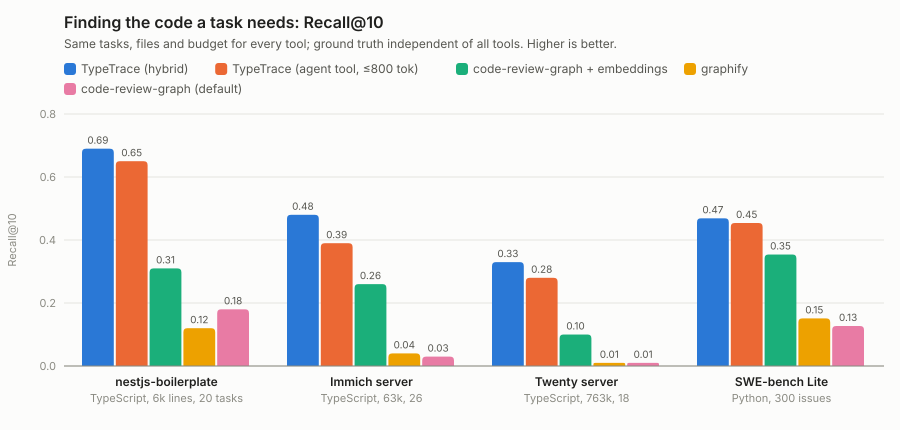
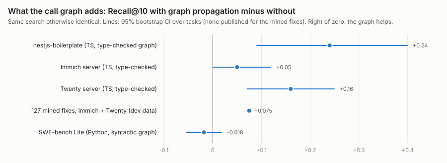
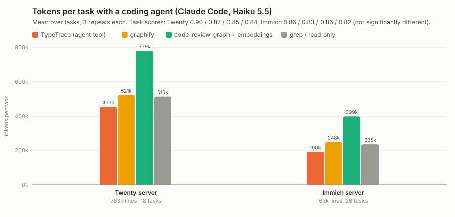

# Do Code Graphs Help Coding Agents Find Code? A Pre-Registered Evaluation of Type-Resolved Call Graphs for Retrieval

**Draft, 2026-11-18.** Every number in this draft comes from a committed result file in this repository; §10 maps
each claim to its source. Section 6.4 (SWE-bench Multilingual) is pending: its run started on 2026-11-18.

*Author: [to be added].*

---

## Abstract

Code-graph tools that plug into AI coding agents through the Model Context Protocol (MCP) report large gains, such as
"~63× fewer tokens" or "80% lower agent token spend". The baselines behind those figures are often not the ones a
developer has in mind. We built TypeTrace, a local MCP server that combines lexical and dense retrieval with
propagation over a call graph resolved by the TypeScript type checker. We evaluated it against graphify and
code-review-graph, two popular open-source code-graph tools, in a series of experiments. Every test was
pre-registered, and the ground truth does not depend on any of the tools.

On three TypeScript repositories from 6k to 763k lines (64 audited tasks), TypeTrace's Recall@10 was 0.33 to 0.69.
Neither competitor exceeded 0.31, and 16 of 18 paired comparisons had p ≤ 0.001. On SWE-bench Lite (300 Python
issues), Recall@10 was 0.469, against 0.354 for code-review-graph with embeddings and 0.151 for graphify (Holm
p ≤ 0.0005).

The call graph's own contribution is conditional. On TypeScript, graph propagation added +0.24, +0.05 and +0.16
Recall@10, concentrated on cross-module tasks (Holm p = 0.019). On Python, where the graph is syntactic, it
added nothing (−0.018, n.s.).

We also ran Claude Code agents in 918 headless sessions on held-out tasks. With a ≤800-token, graph-annotated pointer
list, the agents used 18–28% fewer tokens than with grep alone on a typical task, in all five runs. Agents given
graphify used about as many tokens as grep alone, and agents given code-review-graph used 52–70% more on average.
Accuracy gains over grep alone did not replicate across runs. Graph content added no significant accuracy over the
same tool without the graph (Holm p = 0.44).

The competitors' headline numbers measure different things: the whole repository pasted into the prompt, a hosted
product, or conversational memory.

We release the tool, the harness, the frozen datasets and the decision logs.

---

## 1. Introduction

Coding agents such as Claude Code, Codex and Cursor spend much of a task finding code. They grep, open a file, grep
again, and every file they read costs tokens. A growing set of tools offers to shortcut this search. They index a
repository into a graph of declarations and their relations, and expose it to the agent through MCP. Two of the most
widely used open-source examples are graphify and code-review-graph. Their documentation reports large effects, for
example "~63× fewer tokens", "cut agent token spend by 80%" and "0.497 recall@10".

These numbers are hard to interpret for three reasons:
1. **Baselines.** The baseline is often an extreme: the whole repository pasted into the prompt, which one tool's own
   README calls "an upper bound no real agent pays".
2. **Benchmark domain.** The benchmark is often not code: LOCOMO measures memory over chat conversations.
3. **Circular ground truth.** The ground truth is sometimes derived from the tool's own graph.

None of this is unusual for open-source projects. It does mean that a developer cannot tell from the published
numbers whether a code graph will make their agent find code better or cheaper than the grep it already has.

We ask three questions, each with pre-registered tests:
- **RQ1 (retrieval).** Given a task description, does graph-augmented retrieval find the code the task needs better
  than these tools and than plain search?
- **RQ2 (the graph's own contribution).** Holding the search stack fixed, does propagation over a call graph add
  recall? Does that depend on how precisely the graph is resolved, on the language, and on repository size?
- **RQ3 (agents).** Inside a real coding agent, does the tool change accuracy, tokens or cost?

**Contributions.**
1. **TypeTrace**, an open-source MCP server. It fuses exact-symbol, BM25 and dense retrieval, then propagates scores
   over a call graph resolved by the TypeScript compiler (with dependency injection, decorators, routes and event
   dispatch) or by tree-sitter front-ends for 12 further languages. It returns a ≤800-token list of `file:line`
   pointers with callers and callees (§3).
2. **A scale ladder of real TypeScript repositories.** It spans 6k, 63k and 763k lines and holds 64 independently
   audited tasks. The ground truth comes from merged fixes, a type-checker oracle for change impact, and audits
   frozen before any retrieval output existed (§4).
3. **Pre-registered head-to-heads against graphify and code-review-graph:** retrieval-only on TypeScript and on
   SWE-bench Lite (Python), and agent-level with Claude Code (§5–6).
4. **Negative and conditional results reported as such** (§6, §7): no graph benefit on Python, no replicated agent
   accuracy gain, a cross-encoder reranker that failed its held-out test, and a change-history prior that hurt.
5. **An audit of the competitors' headline claims** against what they measure (§7.3).

## 2. Related work

**Repository-level localisation and retrieval.** SWE-bench [Jimenez et al., 2024] made real GitHub issues the
standard test for repository-level software engineering. Its Lite and Multilingual subsets [Yang et al., 2025] are
used here. Agentless [Xia et al., 2024] showed that a fixed localise–repair–validate pipeline is competitive with
autonomous agents, which makes localisation the step most worth studying in isolation. CodeRAG-Bench [Wang et al.,
2025] finds that retrievers often fail to fetch useful context for code generation.

**Code graphs for LLMs.** RepoGraph [Ouyang et al., 2025] builds a line-level definition–reference graph and plugs
subgraphs into existing SWE-bench frameworks. CodexGraph [Liu et al., 2025] lets an agent query a code graph database
built by static analysis. LocAgent [Chen et al., 2025] gives agents a heterogeneous graph of files, classes and
functions with import, invocation and inheritance edges for multi-hop localisation. These systems use the graph
inside an LLM loop, and their graphs are syntactic or name-resolved, mostly for Python.

Our setting differs in three ways:
- **Retrieval needs no LLM.** The ranking is deterministic, at index and at query time.
- **Type-checker resolution.** The TypeScript graph is resolved by the type checker, including framework dispatch.
- **Separate measurement.** We measure the graph's marginal contribution separately from the search stack it
  augments.

**Embeddings.** We use Qwen3-Embedding-0.6B [Zhang et al., 2025] locally.

**Practitioner tools.** graphify and code-review-graph are the comparison systems (§5.2). To our knowledge, no
independent evaluation of them has been published.

## 3. System: TypeTrace

**Graph construction.**
- **TypeScript and JavaScript** go through the TypeScript compiler API. Calls are resolved by type, not by name. The
  extractor adds edges that grep cannot see:
  - dependency-injected services (NestJS providers);
  - decorators and guards;
  - GraphQL resolvers;
  - keyed event and job dispatch (emitter and queue names resolved to handlers);
  - HTTP routes;
  - Kysely queries to tables.

  Every edge carries a verification label (`static_verified`, `framework_inferred`, `unknown`). Builds are
  deterministic: the SHA-256 of nodes and edges was identical on 21 of 21 rebuilds of the small repository.
- **Python** uses a tree-sitter front-end with scope, import, inheritance (MRO) and `self.attr = X()` resolution.
  Calls it cannot resolve are either inferred by name (at most three candidates) or left out.
- **Go, Java, Kotlin, Scala, C#, Rust, C, C++, Ruby, PHP and Swift** share one tree-sitter engine with per-language
  adapters (`this`/`self`, declared types, constructors, imports, chained calls through return types). Name-only
  links are labelled inferred and kept only in languages where they measured at least 50% correct.

**Retrieval.**
1. **Fusion.** For a natural-language query, four signals are fused: exact symbol-name matches, BM25 over
   declaration chunks, dense similarity (Qwen3-Embedding-0.6B), and graph facts (route paths, event names).
2. **Propagation.** The best seeds propagate score along call, structural and data-flow edges, with hub damping.
3. **Priors.** Declaration-kind priors and a test-path demotion are applied.

All weights were tuned once, on six development tasks of the smallest repository (experiment 1), and frozen. They
were never re-tuned on any later repository or language.

**Output.** Three renderings of the same ranking are evaluated:
- `hybrid`: full ranked results within the budget;
- `custom_graph`: graph-only ranking;
- `compact_graph`: the agent-facing format, at most about 800 tokens of `file:line` pointers with each result's
  callers and callees.

The agent sees one tool, `find_relevant_code`. No LLM is used to build or query the index, and nothing leaves the
machine.

## 4. Benchmarks and ground truth

**TypeScript scale ladder (experiments 1 and 3).**

| | Repository | Lines | Tasks (test) |
|---|---|---:|---:|
| S | nestjs-boilerplate | 6.3k | 20 (14 test) |
| M | Immich server | 63k | 37 (26 test) |
| L | Twenty server | 763k | 24 (18 test) |

Tasks are of five kinds:
- historical bug fixes reverted on the pinned snapshot (40 of 56 Immich drafts verified FAIL_TO_PASS);
- feature-understanding questions;
- change-impact questions, with a type-checker oracle;
- data-flow questions;
- architecture questions.

Each task's ground truth lists the root-cause symbols and the relevant symbols, i.e. the functions on the bug's path
or the functions the question is about. Mean set sizes are 5.2 (Immich) and 7.9 (Twenty). Every task was audited by
an independent pass and adjudicated before any retrieval output existed, then frozen with hashes. The small
repository's 20 tasks are injected bugs, one per snapshot (experiment 1).

**SWE-bench Lite (experiment 5).**
- **Data:** all 300 instances; the query is the issue text, verbatim.
- **Ground truth:** the declarations changed by the gold patch, mapped to the innermost enclosing function or class
  at `base_commit` by a syntactic index that involves no retrieval method. This rule was fixed before any method ran.
- **Size:** 248 of 300 instances have a single ground-truth function (mean 1.2).
- **Corpus:** every `.py` file of the snapshot, tests included.

**SWE-bench Multilingual (experiment 8).** 300 issues in Java, Rust, Go, PHP, Ruby, C, C++, JavaScript and
TypeScript, with the same ground-truth rule. The version we froze has 41 repositories; the dataset's documentation
says 42. The protocol was frozen before any retrieval output existed. Results are pending (§6.4).

**Metrics.**
- **Primary:** symbol Recall@10.
- **Secondary:**
  - root-cause MRR;
  - file Recall@10;
  - output tokens, counted with the o200k tokenizer;
  - latency and index time.

## 5. Experimental design

### 5.1 Pre-registration and analysis

Each experiment has a protocol committed before the runs it governs. Amendments were committed before their own runs,
and a decision log records every change after a protocol was committed. The analysis rules:
- **Unit:** the task (agent repeats averaged).
- **Paired tests:** one-sided sign-flip permutation tests (exact up to 2^16 sign patterns, otherwise 20,000 seeded
  random flips) with bootstrap 95% CIs.
- **Multiplicity:** Holm correction within each pre-registered family.
- **Labels:** everything outside a family is labelled exploratory.

Losses and null results are reported.

### 5.2 Competitors

- **graphify** v0.9.108: AST-only graph, its own `query`.
- **code-review-graph** v2.4.0:
  - default: SQLite FTS5 search;
  - with its documented local embeddings (all-MiniLM-L6-v2). This is its strongest documented setup.
  - As a control, re-run with our embedding model (Qwen3-Embedding-0.6B) served through its OpenAI-compatible
    provider interface.

Both are vendored at pinned commits and run as shipped. Every method indexes exactly the same files, through a
neutral copy of the corpus.

In the agent arms, each competitor runs through its own native MCP server with every read-only tool it ships. Two
bugs in our harness were found and fixed, and both disadvantaged a competitor:
1. graphify's graph was unreachable in the agent arm;
2. code-review-graph indexed the fixed code on bug tasks.

Both are recorded in the decision log, with reruns.

### 5.3 Agent harness

- **Agent:** Claude Code, headless, Claude Haiku 5.5 and Sonnet 5.5.
- **Workspace:** an isolated copy of the workspace, with no `.git`, no dependencies and no ground truth.
- **Tools:** Read, Grep and Glob, plus the arm's MCP server.
- **Limits:** a 40-turn cap and identical prompts per arm.
- **Scoring:** answers are structured and scored automatically against the frozen ground truth, with no LLM judge.
  Bug tasks score 1 when the root cause is among the first three locations; other tasks score recall of the relevant
  symbols.
- **Arms:**
  - A0: grep and read only;
  - A1: our compact tool without graph propagation;
  - A2: our compact tool;
  - A5: graphify;
  - A6: code-review-graph with embeddings.
- **Isolation:** no user configuration reached the agent, which was verified from recorded requests.

## 6. Results

### 6.1 RQ1: retrieval against the competitors

*Figure 1. Recall@10 on the three TypeScript repositories (test splits; S all tasks) and on SWE-bench Lite.*

**TypeScript** (test splits; S uses all 20 tasks):

| Repository | TypeTrace `hybrid` | TypeTrace `compact_graph` | CRG + embeddings | CRG default | graphify |
|---|---:|---:|---:|---:|---:|
| S (6.3k lines, 20) | **0.69** | 0.65 | 0.31 | 0.18 | 0.12 |
| M (63k, 26) | **0.48** | 0.39 | 0.26 | 0.03 | 0.04 |
| L (763k, 18) | **0.33** | 0.28 | 0.10 | 0.01 | 0.01 |

Sixteen of the 18 TypeTrace-vs-competitor comparisons have p ≤ 0.001. The two exceptions are on M against
code-review-graph with embeddings: `hybrid` +0.21 (p = 0.025) and `compact_graph` +0.12 (p = 0.12).

The embedding model explains part of the gap, but not all of it:
- Qwen3 alone, with no graph and no BM25, beats code-review-graph with MiniLM (0.51 vs 0.31, 0.47 vs 0.26, 0.19 vs
  0.10).
- Given Qwen3, code-review-graph scores 0.28, 0.23 and 0.17, still 0.16 to 0.41 below TypeTrace on every repository
  (p < 0.01 each).

**Python, SWE-bench Lite** (300 issues):

| Method | Recall@10 | RC MRR | File R@10 | Output tokens |
|---|---:|---:|---:|---:|
| TypeTrace without graph (`hybrid_nograph`) | **0.487** | **0.316** | 0.800 | 7,660 |
| TypeTrace `hybrid` | 0.469 | 0.296 | 0.800 | 6,124 |
| TypeTrace `compact_graph` | 0.454 | 0.289 | 0.747 | 748 |
| embeddings (Qwen3-0.6B) | 0.419 | 0.238 | 0.780 | 7,013 |
| BM25 | 0.392 | 0.249 | 0.700 | 7,540 |
| code-review-graph + embeddings | 0.354 | 0.200 | 0.717 | 7,288 |
| graph-only ranker | 0.312 | 0.179 | 0.677 | 5,741 |
| graphify | 0.151 | 0.083 | 0.667 | 6,570 |
| code-review-graph default | 0.127 | 0.085 | 0.240 | 3,824 |

The pre-registered tests:

| Test | Δ Recall@10 | 95% CI | Holm p |
|---|---:|---|---:|
| P1: `hybrid` > graphify | +0.318 | [+0.259, +0.375] | 0.0001 |
| P2: `hybrid` > code-review-graph + embeddings | +0.115 | [+0.057, +0.173] | 0.0005 |

Why the competitors score low:
- **code-review-graph's default search** returned nothing for 178 of 300 issue texts. Its documentation says that
  natural-language queries return nothing without embeddings.
- **graphify** usually finds the right file (file R@10 0.667), but rarely the function. Its `query` returns the
  neighbourhood of keyword-matched nodes, not ranked functions.

The same two patterns appear on TypeScript, where we inspected raw outputs and audited the normaliser. The normaliser
credits each tool's results by name or line range, with identical rules for every tool.

### 6.2 RQ2: the graph's own contribution

*Figure 2. Recall@10 of the fused search with graph propagation minus the identical search without it.*

The contrast is the same fused search with and without propagation (`hybrid` vs `hybrid_nograph`, identical
otherwise).

| Setting | Graph | Δ Recall@10 [95% CI] |
|---|---|---|
| S, TypeScript (experiment 1, 14 test tasks) | type-checked | +0.24 [+0.08, +0.40] (ablation) |
| S, TypeScript (experiment 3) | type-checked | +0.24 [+0.09, +0.40] |
| M, TypeScript | type-checked | +0.05 [0.00, +0.12] |
| L, TypeScript | type-checked | +0.16 [+0.07, +0.25] |
| M+L, cross-module tasks minus local tasks | type-checked | +0.12 [+0.03, +0.21], Holm p = 0.019 (H2) |
| Immich + Twenty, 127 mined fixes (development data) | type-checked | +0.075, p = 0.010 |
| SWE-bench Lite, Python | syntactic | **−0.018 [−0.055, +0.019]**, Holm p = 0.83 (P3) |

The pre-registered scale hypothesis (H1) was not supported: the effect does not grow monotonically with size. The
slope of the graph effect is +0.06 per 10× lines [−0.02, +0.15] on nested sub-corpora of Twenty. Within Twenty, as
unrelated code is added around the same tasks, the search without the graph loses recall (0.32 → 0.20 → 0.17) while
the graph-propagated search holds up better (0.42 → 0.43 → 0.33). On the experiment 1 ablation, call-graph traversal
was the only graph component with a measurable effect. Control-flow, data-flow, confidence and
framework-dispatch edges each had none.

**Why no effect on Python.** In the 24 Lite instances where the graph lowered recall, propagation added close
neighbours of the best seeds (sibling methods, constructors, tests that call the function), and these pushed the
single changed function out of the top 10. The 17 wins are the same mechanism working the other way. Two plausible
explanations, neither tested:
1. **Graph precision.** In a typical snapshot only about 21% of call sites resolve from scopes, imports and `self`
   types; 12% are name-inferred and 67% are left unresolved.
2. **Ground truth.** SWE-bench credits only the changed functions, while our TypeScript tasks also count the path.
   Against this, the graph helped on TypeScript with changed-functions-only ground truth (the 127 mined fixes).

### 6.3 RQ3: inside a coding agent

*Figure 3. Tokens per task in the head-to-head agent runs (Claude Haiku 5.5).*

**Head-to-head runs** (Claude Haiku 5.5; 3 repeats per task and arm):

| Repository | Arm | Task score | Tokens / task | Cost / task |
|---|---|---:|---:|---:|
| L (18 tasks) | A2 TypeTrace | 0.896 | 453k | $0.019 |
| | A5 graphify | 0.867 | 521k | $0.022 |
| | A6 code-review-graph + emb. | 0.851 | 779k | $0.041 |
| | A0 grep / read only | 0.837 | 513k | $0.023 |
| M (26 tasks) | A2 TypeTrace | 0.860 | 190k | $0.013 |
| | A5 graphify | 0.833 | 248k | $0.013 |
| | A6 code-review-graph + emb. | 0.859 | 399k | $0.019 |
| | A0 grep / read only | 0.816 | 235k | $0.013 |

**Pre-registered families.**
- **Amendment D (Holm over four, per repository):**
  - Tokens, TypeTrace < graphify: L Holm p = 0.003, M p < 0.001.
  - Tokens, TypeTrace < code-review-graph: p < 0.001 on both.
  - Accuracy, TypeTrace > either competitor: not significant on either repository (Holm p 0.26 to 0.47).
- **Amendment C (L, Haiku):**
  - H3, tokens A2 < A0: supported, log ratio +0.20 [+0.10, +0.30], Holm p = 0.002.
  - H4, graph content in the agent (A2 − A1): +0.021 [−0.014, +0.069], Holm p = 0.44, not supported.

**Replication against grep alone.** Five independent runs compared A2 with A0:

| Run | Δ task score | Tokens, typical task | Non-inferiority (lower bound > −0.05) |
|---|---:|---:|---|
| L Haiku (Amendment C) | −0.016 | −18% (p = 0.001) | missed (−0.057) |
| M Haiku (Amendment C, exploratory) | +0.007 | −28% (p < 0.001) | missed (−0.058) |
| L Haiku (head-to-head) | +0.059 (p = 0.027) | −21% (p = 0.008) | met (+0.015) |
| M Haiku (head-to-head) | +0.044 (p = 0.024) | −28% (p < 0.001) | met (+0.012) |
| L Sonnet (exploratory) | +0.028 | −18% (p = 0.028) | met (−0.009) |

**The token reduction replicates. An accuracy gain does not.**

**Competitors vs grep alone** (averages per task):
- graphify used 2% more tokens on L and 6% more on M.
- code-review-graph used 52% and 70% more.

Agents still read the files after the graph answers, so a larger tool output adds to the reading rather than
replacing it.

**Cost.** Token savings became dollar savings on L. On M, cost per task was about the same as graphify and grep
alone, because cached prompt tokens are cheap.

**Earlier result (experiment 2, small repository, Sonnet).** The agent with Read/Grep/Glob was at ceiling with or
without retrieval tools. Left to choose, it never called a retrieval tool. Given retrieved context in a single call
with no tools, accuracy rose from 31–33% (file list only) to 71–98% (graph-based or hybrid context).

### 6.4 SWE-bench Multilingual (pending)

Pre-registered (experiment 8), with the same tests as Lite: P1 vs graphify, P2 vs code-review-graph with embeddings,
and P3 for the graph's contribution in nine languages. The run started on 2026-11-18. This section will report it
when it finishes, whatever the result.

## 7. Discussion

### 7.1 When does a code graph help?

Our evidence supports a narrow claim. Propagating scores from good lexical and semantic seeds along call edges
retrieves more of the code involved in a task when two conditions hold:
1. **The graph is precise.** It is resolved by a type checker, including framework dispatch.
2. **The task spans modules.**

It does not support the broader claim that "a code graph helps". With a syntactic Python graph, propagation added as
much noise as signal. On a mid-sized repository with mostly local tasks (Immich), the effect was small. Seed quality
dominates: in our ablations the embedding model and BM25 seeds account for most of the gap to the competitors.

### 7.2 Retrieval gains vs agent gains

Retrieval gains of 0.1 to 0.3 Recall@10 did not become reliable accuracy gains inside the agent. A capable agent with
grep recovers most of the missing context by reading more files, which costs tokens. What the tool changes reliably is
how much the agent reads: a ≤800-token pointer list replaces several rounds of grep and open.

The size of the tool's output matters as much as its ranking. code-review-graph's arm used the most tokens despite the
second-best retrieval, because its outputs are large and the agent still read the files.

### 7.3 What the headline claims measure

| Claim | What it compares | Closest measurement here |
|---|---|---|
| code-review-graph: "~63× fewer tokens" | the whole repository in the prompt vs one graph answer; its README calls this baseline "an upper bound no real agent pays" | its own comparison against grep is 6.65× (tokens to locate an answer); in our agent runs, +52–70% tokens vs grep |
| graphify: "cut agent token spend by 80%" | its paid hosted product | the open-source tool: +2–6% tokens vs grep |
| graphify: "0.497 recall@10" | LOCOMO: memory over chat conversations, no code | our search stack on an open LOCOMO protocol: 0.745 (BM25 0.540); different harness, so not a like-for-like comparison |
| code-review-graph: impact F1 0.69 | ground truth from its own graph ("a circular upper bound") | not run; our impact tasks use a type-checker oracle |

### 7.4 Other negative results (experiment 6)

Six further directions were tested on development data:
- **A change-history prior.** Recently changed files do predict where fixes land, but adding the prior to text
  retrieval lowered MRR everywhere.
- **Commit titles as file descriptions.** Not robust.
- **A cross-encoder reranker.** It looked positive on development data, then failed its pre-registered held-out test:
  Δ +0.005 [−0.035, +0.045], p = 0.40.
- Three others showed no reliable gain.

Engineering work made queries 13 to 46 times faster with byte-identical output: on the 763k-line repository, 13.3 s
became 0.29 s.

## 8. Threats to validity

- **Home ground.** TypeTrace was designed around TypeScript, and its weights were tuned on a TypeScript repository.
  The TypeScript benchmarks were built by the tool's authors, albeit from upstream fixes and with independent audits.
  SWE-bench Lite and Multilingual were added because they were chosen by others.
- **Sample sizes.** The agent runs use 18 to 26 tasks per repository. Accuracy differences below about 0.05 are not
  resolvable.
- **Models.** Only Claude Haiku 5.5 and Sonnet 5.5, in one agent (Claude Code). All repositories are public, so models
  and the embedding model may have seen them; this applies to every arm that uses them.
- **Competitor configuration.** Competitors ran as shipped, and we added code-review-graph's documented embeddings and
  a same-embedder control. A different configuration, or a version newer than the ones pinned here, could score
  differently.
- **Retrieval metrics.** Recall@10 measures what an agent is shown first, not whether it fixes the issue. We did not
  measure resolution rates.
- **Scale cost.** On 763k lines the TypeScript graph takes 81 s and 4.0 GB to build. Third-party types are stubbed to
  fit a 15 GB machine. First-time CPU embedding takes about 3.5 h.

## 9. Conclusion

A type-resolved call graph combined with strong lexical and dense search finds the code a task needs substantially
better than two popular code-graph MCP tools: on three TypeScript repositories and on 300 Python issues chosen by
others. Inside a coding agent, the robust benefit is fewer tokens, not more correct answers. The graph itself helps
when it is precise and the task crosses modules, and not otherwise. Large headline numbers for code-graph tools
usually reflect their baselines. We hope the pre-registered protocols, frozen datasets and decision logs released
with this paper make such claims easier to check.

## 10. Claim-to-source map

| Claim | Source in this repository |
|---|---|
| TypeScript retrieval head-to-head | `experiments/03-graph-scale/results/h2h-report.md` |
| Graph effect on TypeScript (H1, H2) | `experiments/03-graph-scale/results/stage1-report-test.md`, `README.md` (experiment 3) |
| Experiment 1 ablation | `research/findings.md`, `evaluation/results/ablation-test/` |
| SWE-bench Lite | `experiments/05-swebench-python/findings.md`, `results/report.md` |
| Agent runs | `experiments/03-graph-scale/results/agent/*-report.md`, decision log E3-D26 |
| Experiment 2 | `experiments/02-agent-diagnosis/findings.md` |
| Experiment 6 | `experiments/06-next-direction/findings.md` |
| Graph quality, 11 languages | `experiments/07-languages/README.md` |
| LOCOMO | `experiments/04-locomo/` |

## References

- Chen, Z., Tang, X., et al. (2025). LocAgent: Graph-Guided LLM Agents for Code Localization. arXiv:2503.09089.
- Holm, S. (1979). A simple sequentially rejective multiple test procedure. *Scandinavian Journal of Statistics*, 6(2), 65–70.
- Jimenez, C. E., Yang, J., et al. (2024). SWE-bench: Can Language Models Resolve Real-World GitHub Issues? ICLR 2024. arXiv:2310.06770.
- Liu, X., Lan, B., et al. (2025). CodexGraph: Bridging Large Language Models and Code Repositories via Code Graph Databases. NAACL 2025. arXiv:2408.03910.
- Maharana, A., et al. (2024). Evaluating Very Long-Term Conversational Memory of LLM Agents. ACL 2024. arXiv:2402.17753.
- Ouyang, S., et al. (2025). RepoGraph: Enhancing AI Software Engineering with Repository-level Code Graph. ICLR 2025. arXiv:2410.14684.
- Robertson, S., & Zaragoza, H. (2009). The Probabilistic Relevance Framework: BM25 and Beyond. *Foundations and Trends in Information Retrieval*, 3(4), 333–389.
- Wang, Z. Z., Asai, A., et al. (2025). CodeRAG-Bench: Can Retrieval Augment Code Generation? Findings of NAACL 2025. arXiv:2406.14497.
- Xia, C. S., Deng, Y., Dunn, S., & Zhang, L. (2024). Agentless: Demystifying LLM-based Software Engineering Agents. arXiv:2407.01489.
- Yang, J., et al. (2025). SWE-smith: Scaling Data for Software Engineering Agents. arXiv:2504.21798. (Introduces SWE-bench Multilingual.)
- Zhang, Y., et al. (2025). Qwen3 Embedding: Advancing Text Embedding and Reranking Through Foundation Models. arXiv:2506.05176.
- graphify, v0.9.108, https://github.com/Graphify-Labs/graphify (software).
- code-review-graph, v2.4.0, https://github.com/tirth8205/code-review-graph (software).
